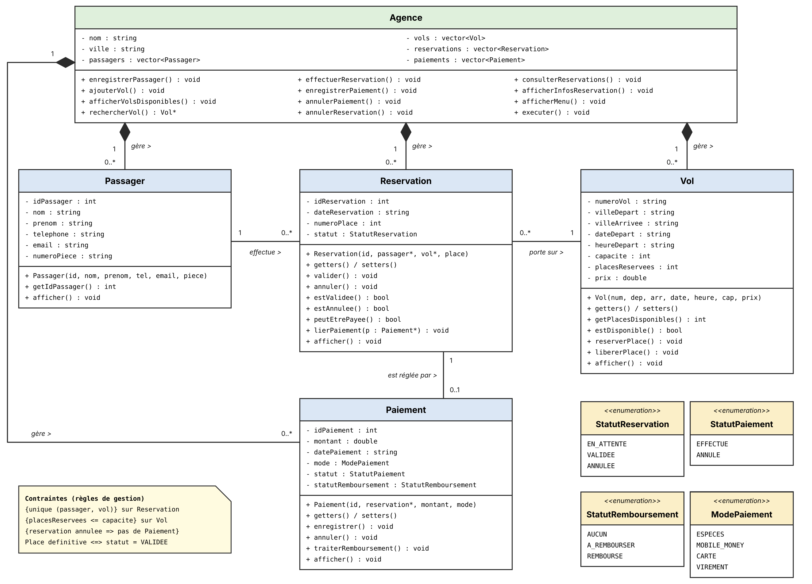

# Gestion d'une agence de voyage (C++ / POO)

Application console en C++17 qui permet à une agence de voyage située à **Cotonou** d'informatiser la gestion de ses **vols** et de ses **réservations de billets d'avion** : passagers, vols, réservations, paiements et annulations.

Projet réalisé selon les principes de la Programmation Orientée Objet : encapsulation, constructeurs, associations entre objets, collections `vector`, gestion des erreurs de saisie et des opérations interdites.

## Contenu du projet

| Fichier | Description |
|---|---|
| `README.md` | Présentation du projet (ce fichier) |
| `Analyse_Agence_de_Voyage.pdf` | Analyse : classes, attributs, méthodes, associations, multiplicités, diagramme UML |
| `agence.puml` | Code PlantUML du diagramme de classes |
| `diagramme_classes.png` | Image du diagramme de classes |
| `main.cpp` | Code source C++ complet |

## Diagramme de classes



Le diagramme comporte 5 classes (`Agence`, `Passager`, `Vol`, `Reservation`, `Paiement`) et 4 énumérations (`StatutReservation`, `StatutPaiement`, `StatutRemboursement`, `ModePaiement`). Pour le régénérer, collez le contenu de `agence.puml` sur [plantuml.com](https://www.plantuml.com/plantuml) ou dans un éditeur PlantUML.

## Fonctionnalités

Menu principal de l'application :

1. Enregistrer un passager
2. Ajouter un vol
3. Afficher les vols disponibles
4. Rechercher un vol (par numéro ou par ville)
5. Effectuer une réservation
6. Enregistrer un paiement
7. Annuler un paiement / une réservation
8. Consulter des réservations (toutes, par passager ou par vol)
9. Afficher les informations d'une réservation
10. Quitter

## Règles de gestion

- **R1** : un passager doit être enregistré avant de pouvoir réserver un billet.
- **R2** : un vol ne peut pas recevoir plus de réservations que sa capacité.
- **R3** : un passager ne peut pas être enregistré deux fois sur le même vol.
- **R4** : une réservation est associée à un seul passager et à un seul vol.
- **R5** : une réservation annulée ne peut plus être utilisée pour effectuer un paiement.
- **R6** : une place n'est définitivement réservée qu'après validation de la réservation.
- **R7** : une réservation payée puis annulée est traitée selon le statut de remboursement (`AUCUN`, `A_REMBOURSER`, `REMBOURSE`).

## Compilation et exécution

Un compilateur C++17 est nécessaire (g++ 7 ou plus récent, clang, ou Visual Studio 2017 et plus).

**Linux, macOS, Windows (MinGW / MSYS2) :**

```bash
g++ -std=c++17 -Wall -Wextra -pedantic -o agence main.cpp
./agence            # démarrage à vide
./agence --demo     # avec 3 passagers et 3 vols d'exemple
```

**Windows avec Visual Studio (invite de commandes développeur) :**

```bat
cl /EHsc /std:c++17 /utf-8 main.cpp /Fe:agence.exe
agence.exe --demo
```

Sous Windows, le programme active l'encodage UTF-8 de la console pour afficher les accents. Si des caractères incorrects apparaissent, exécutez `chcp 65001` avant de lancer le programme.

## Organisation du code

- **Exceptions** : `ErreurMetier` (règle de gestion violée), `FinDeSaisie` (fin du flux d'entrée).
- **`namespace Validation`** : contrôle des données (nom, téléphone, email, pièce d'identité, numéro de vol, date, heure).
- **`namespace Saisie`** : lecture clavier sécurisée, la saisie est redemandée tant qu'elle est invalide.
- **Classes métier** : `Passager`, `Vol`, `Reservation`, `Paiement`. Les attributs sont privés et les constructeurs valident leurs arguments.
- **`Agence`** : contient les collections (`vector`) et les opérations du menu, et applique les règles qui font intervenir plusieurs objets.

## Choix de conception

- Les collections sont des `vector<unique_ptr<T>>` : les réservations gardent des pointeurs vers les passagers, vols et paiements, et ces adresses doivent rester stables quand un `vector` grandit.
- Une place est retenue dès la création de la réservation (pour respecter R2) et devient définitive à sa validation (R6). Un paiement valide automatiquement une réservation en attente.
- Annuler un paiement laisse la réservation valide mais impayée ; annuler une réservation payée annule aussi son paiement et déclenche le suivi du remboursement (R7).
- Le montant d'un paiement est le prix du vol.

## Captures d'écran

Lancez `./agence --demo`, effectuez quelques opérations (réservation, paiement, annulation) et prenez des captures de la console pour illustrer l'exécution.
